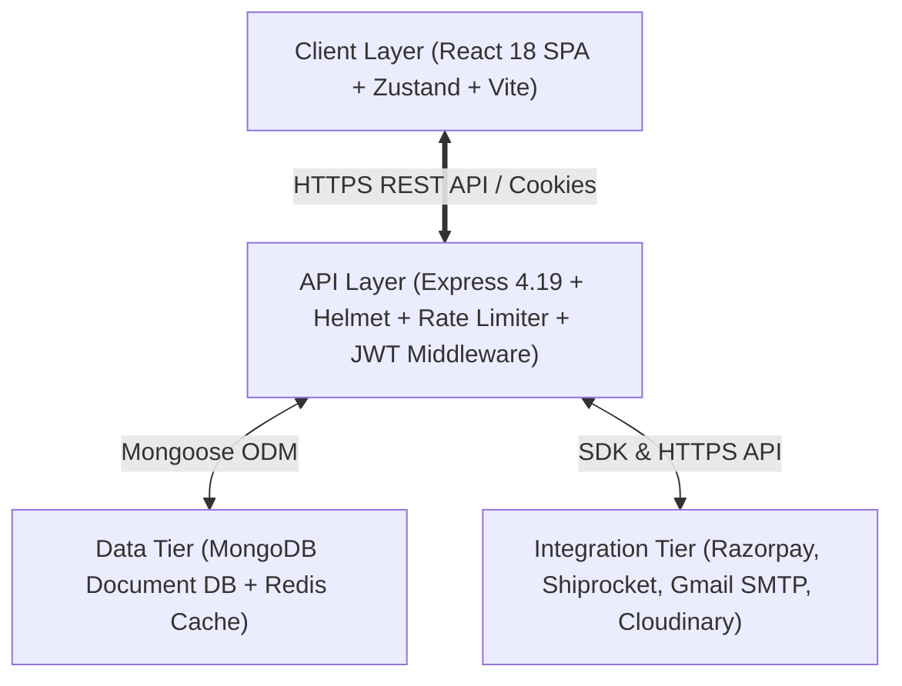
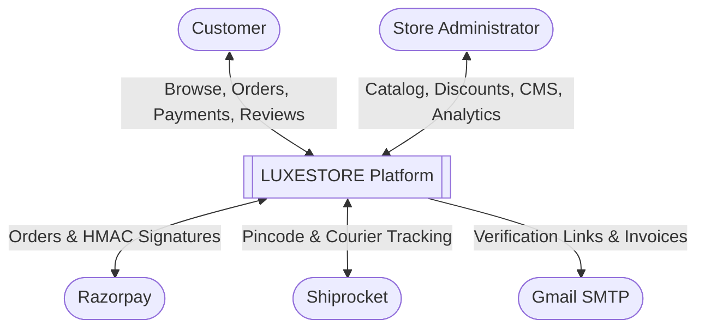
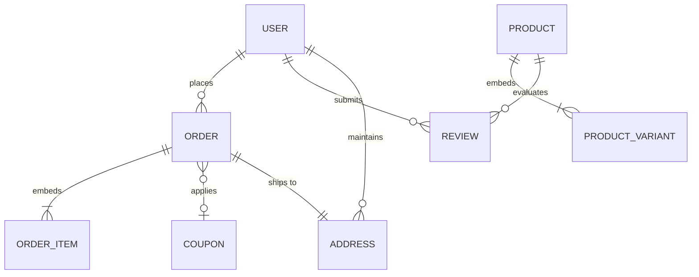

# LUXESTORE — Master Consolidated Technical Documentation

> **Academic Project Submission**: Final Year Project & Technical Viva Examination  
> **Degree**: Bachelor of Technology (B.Tech) in Computer Science & Engineering  
> **Project Title**: LUXESTORE — Haute Atelier & Luxury Fashion E-Commerce Web Platform  
> **Architecture**: Full-Stack MERN (MongoDB, Express.js, React 18, Node.js) with Redis Caching, Razorpay Payments, and Shiprocket Logistics  
> **Audit Status**: Fully Verified Against Live Codebase & Database (November 2026)  

---

## Table of Contents

1. [Executive Summary & Abstract](#1-executive-summary--abstract)
2. [Master Technology Stack & Verified Package Matrix](#2-master-technology-stack--verified-package-matrix)
3. [System Architecture & Data Flow Diagrams](#3-system-architecture--data-flow-diagrams)
4. [Software Requirements Specification (SRS) Core Modules](#4-software-requirements-specification-srs-core-modules)
5. [Database Architecture & Entity-Relationship Modeling](#5-database-architecture--entity-relationship-modeling)
6. [Complete REST API Route Directory](#6-complete-rest-api-route-directory)
7. [Security Architecture & Cryptographic Integrity](#7-security-architecture--cryptographic-integrity)
8. [Logistics & Payment Processing Workflows](#8-logistics--payment-processing-workflows)
9. [Testing Documentation & QA Audit Results](#9-testing-documentation--qa-audit-results)
10. [Deployment, Infrastructure & Environment Specifications](#10-deployment-infrastructure--environment-specifications)
11. [Current Limitations & Future Development Scope](#11-current-limitations--future-development-scope)
12. [Academic Defense & Documentation Directory Map](#12-academic-defense--documentation-directory-map)

---

## 1. Executive Summary & Abstract

**LUXESTORE** is an enterprise-grade digital retail web platform designed specifically for high-fashion luxury apparel. Built on modern web architecture patterns, the application solves fundamental industry bottlenecks:
- **Multi-Dimensional Variant SKU Management**: Accommodating clothing items defined by size, color swatches, stock availability, and physical measurements.
- **Deterministic PIN-Code Logistics**: Real-time integration with Shiprocket courier APIs checking live delivery feasibility and dynamic partner routing (e.g., Blue Dart Air).
- **Server-Side Financial Integrity**: Razorpay payment order initiation in paise coupled with HMAC-SHA256 cryptographic signature validation.
- **Hardened Email Identity Verification**: A pure email/password authentication system utilizing bcrypt password hashing (10 salt rounds), secure verification URL links containing a 32-byte cryptographic token (SHA-256 hashed in database with 15-minute expiration), and dual JWT tokens stored in HTTP-only cookies (`accessToken`: 15m; `refreshToken`: 7d).
- **Purchase-Verified Feedback**: Reviews and ratings are cryptographically locked to customers with paid, completed, and non-cancelled orders.

---

## 2. Master Technology Stack & Verified Package Matrix

| Component | Technology | Installed Version | Declared Range | Architectural Role |
| :--- | :--- | :--- | :--- | :--- |
| **Runtime** | Node.js | `v24.11.1` (Active) | *Not declared* | Host JavaScript Execution Environment |
| **Backend Framework**| Express.js | `4.19.2` | `^4.19.2` | REST API Server & HTTP Routing |
| **Database ODM** | Mongoose | `8.5.3` | `^8.5.3` | MongoDB Object Data Modeling |
| **Authentication** | JSON Web Tokens | `9.0.2` | `^9.0.2` | Stateless Dual-Token Authorization |
| **Password Hashing** | BCrypt.js | `2.4.3` | `^2.4.3` | Salted Password Hash Generation |
| **Rate Limiter** | express-rate-limit | `8.7.1` | `^8.7.1` | Auth Route Brute-Force Throttling |
| **Security Headers** | Helmet | `8.3.0` | `^8.3.0` | HTTP Header Hardening |
| **Payment Gateway** | Razorpay SDK | `2.9.8` | `^2.9.8` | Payment Order Generation & Signature Verification |
| **Secondary Payment**| Stripe SDK | `16.8.0` | `^16.8.0` | Secondary International Checkout |
| **Logistics API** | Shiprocket | REST API v2 | REST API v2 | PIN Code Serviceability & Courier Tracking |
| **Email Transporter**| Nodemailer | `10.2.1` | `^10.2.1` | Gmail SMTP Transactional Communication |
| **In-Memory Cache** | ioredis | `5.4.1` | `^5.4.1` | Redis Caching with Graceful Offline Fallback |
| **Media Storage** | Cloudinary SDK | `2.4.0` | `^2.4.0` | Edge CDN Media Storage & Optimization |
| **Frontend UI Engine**| React | `18.3.1` | `^18.3.1` | Declarative Virtual DOM View Layer |
| **Frontend DOM** | React DOM | `18.3.1` | `^18.3.1` | Browser DOM Mounting Engine |
| **SPA Router** | React Router DOM | `6.26.1` | `^6.26.1` | Client Routing & Protected Guards |
| **State Management**| Zustand | `4.5.5` | `^4.5.5` | Reactive Flux Micro-Stores |
| **HTTP Client** | Axios | `1.7.5` | `^1.7.5` | Promise REST Client with Credentials |
| **CSS Framework** | Tailwind CSS | `3.4.10` | `^3.4.10` | Utility CSS & Dark Mode (`class`) |
| **Animation Engine**| Framer Motion | `11.3.30` | `^11.3.30` | Editorial Page Transitions & Carousels |
| **Analytics Charts**| Recharts | `2.12.7` | `^2.12.7` | SVG Data Visualizations |
| **Store Locator Map**| Leaflet / React-Leaflet | `1.9.4` / `4.2.1` | `^1.9.4` / `^4.2.1` | Interactive Physical Atelier Mapping |
| **Frontend Bundler**| Vite | `5.4.2` | `^5.4.1` | Fast HMR Dev Server & Rollup Production Bundler |

---

## 3. System Architecture & Data Flow Diagrams

### 3.1 3-Tier Layered Architecture

### 3.2 Context-Level Data Flow (DFD Level 0)

---

## 4. Software Requirements Specification (SRS) Core Modules

The software requirements comply with IEEE standards and categorize system behavior under four distinct actors and six primary functional modules:

1. **Authentication Module (`FR-AUTH-*`)**: Email signup, secure verification link with 32-byte cryptographic token, login, dual-cookie JWT issuance, 15-minute expiring password reset links, and complete wishlist/cart purging on logout.
2. **Catalog Discovery Module (`FR-PROD-*`)**: Multi-variant SKU filtering (size, color, price), full-text catalog search, dynamic sizing guides, and physical store locator mapping.
3. **Cart & Wishlist Module (`FR-CART-*`)**: Authenticated shopping cart synchronization, persistent wishlists, and deduplicated recently viewed browsing history (`FR-ENG-*`).
4. **Logistics & Delivery Module (`FR-SHIP-*`)**: Real-time courier serviceability checking via Shiprocket and automatic free delivery on orders $\ge$ ₹1,999.
5. **Coupons & Payments Module (`FR-PAY-*`)**: Promotional voucher validation enforcing minimum cart purchase requirements and discount caps (`WELCOME10`: min order ₹999, cap ₹1,500; `FASHION15`: min order ₹1,499, cap ₹2,000), Razorpay INR payment order generation, and server-side HMAC-SHA256 signature verification.
6. **Administration & Analytics Module (`FR-ADM-*`)**: Revenue charts, inventory restocking, flash sale scheduling, marquee announcement management, and support ticket resolution.
7. **Seller Module (`FR-ADM-004`)**: Multi-vendor marketplace portal is **unimplemented / planned future scope**.

---

## 5. Database Architecture & Entity-Relationship Modeling

The database utilizes **MongoDB** via Mongoose schemas. The system balances embedded subdocuments against normalized document references:

### Collection Inventory (23 Models):
- `User`: Primary identity, role (`customer` / `admin`), credentials, embedded cart, and verification state.
- `Product`: Haute couture catalog items with embedded `variants` array and `colors`.
- `Order`: Financial invoices, line items, payment status, and tracking info.
- `Coupon`: Promotional vouchers with discount type, value, caps, and `minOrderAmount`.
- `Review`: Verified feedback with title, rating (1-5), and Cloudinary images.
- `Address`: Shipping address book with normalized E.164 phone numbers.
- `EmailLog`: Audit record of all transactional email transmissions.
- *Supporting Collections*: `Announcement`, `BrowsingHistory`, `CampaignSlide`, `Category`, `CmsContent`, `Newsletter`, `Notification`, `RestockSubscription`, `Sale`, `SearchQuery`, `ServiceableLocation`, `SizeChart`, `StoreLocation`, `WarehouseSetting`, and `OTP`.

---

## 6. Complete REST API Route Directory

The Express application mounts **22 dedicated route files** across 24 controllers:

| Base Path | Router File | Authentication | Primary Operations |
| :--- | :--- | :--- | :--- |
| `/api/auth` | `auth.route.js` | Public / Rate Limited | Signup, verify-email, login, logout, password reset |
| `/api/products` | `product.route.js` | Public / Admin | Product catalog retrieval, CRUD, variant management |
| `/api/reviews` | `review.route.js` | Protected | Verified purchase reviews submission and rating queries |
| `/api/categories` | `category.route.js` | Public / Admin | Apparel department taxonomy management |
| `/api/cart` | `cart.route.js` | Protected | Database-synced cart additions, updates, removals |
| `/api/coupons` | `coupon.route.js` | Public / Admin | Promo code validation and administration |
| `/api/payments` | `payment.route.js` | Protected | Razorpay order creation and HMAC signature check |
| `/api/analytics` | `analytics.route.js` | Admin Only | Store revenue, conversion metrics, sales charts |
| `/api/users` | `user.route.js` | Protected | Profile management and wishlist toggling |
| `/api/notifications` | `notification.route.js` | Protected | Customer alerts and order updates |
| `/api/recommendations` | `recommendation.route.js` | Optional / Protected | Browsing history deduplication and related items |
| `/api/sales` | `sale.route.js` | Public / Admin | Flash sales and seasonal promotions |
| `/api/serviceability` | `serviceability.route.js` | Public | Shiprocket PIN code delivery feasibility check |
| `/api/addresses` | `address.route.js` | Protected | Customer address book CRUD and default toggles |
| `/api/admin/customers` | `customer.route.js` | Admin Only | Customer directory, order counts, status |
| `/api/shipping` | `shipping.route.js` | Protected / Admin | Courier assignments and dispatch tracking |
| `/api/orders` | `order.route.js` | Protected / Admin | Order history, detail modals, pre-dispatch cancellations |
| `/api/campaign-slides` | `campaignSlide.route.js` | Public / Admin | Editorial homepage hero campaign carousels |
| `/api/announcements` | `announcement.route.js` | Public / Admin | Header marquee promotion banners |
| `/api/restock-subscriptions`| `restockSubscription.route.js`| Protected | Out-of-stock SKU back-in-stock alert signups |
| `/api/cms` | `cms.route.js` | Public / Admin | Brand policies, sizing information, editorial copy |
| `/api/size-charts` | `sizeChart.route.js` | Public / Admin | Category measurement matrices (chest, waist, hips) |
| `/api/support-tickets` | `supportTicket.route.js` | Protected / Admin | Customer care communication threads |
| `/api/newsletter` | `newsletter.route.js` | Public | Newsletter subscriptions with email normalization |

---

## 7. Security Architecture & Cryptographic Integrity

1. **Password Hashing**: Salted Blowfish cipher with 10 salt rounds (`bcryptjs`).
2. **Session Security**: Pure HTTP-only cookies (`accessToken` 15m; `refreshToken` 7d) configured with `SameSite: 'strict'`, completely preventing JavaScript XSS token theft.
3. **Verification Security**: The 32-byte cryptographic token is hashed using SHA-256 (`verificationTokenHash`) in MongoDB, ensuring raw tokens are never persisted in plaintext.
4. **Financial HMAC-SHA256**: Razorpay order payments are verified byte-for-byte on the backend using `crypto.createHmac("sha256", secret).update(order_id + "|" + payment_id).digest("hex")`.
5. **Header Hardening**: `helmet` blocks MIME sniffing, clickjacking, and enforces transport security.
6. **Multi-Tier Rate Limiting**: `express-rate-limit` prevents brute-force credential stuffing on `/api/auth` (100 general / 15 recovery requests per 15 minutes).

---

## 8. Logistics & Payment Processing Workflows

### 8.1 Payment Lifecycle (Razorpay Standard)
1. **Price Validation**: Backend computes subtotal from real database records, never trusting client totals.
2. **Order Creation**: Calls Razorpay API to generate an order in integer paise.
3. **Client Checkout**: Razorpay standard modal collects payment via UPI, Cards, or NetBanking.
4. **Server Verification**: Backend checks HMAC-SHA256 signature, commits order document, decrements variant stock, flushes user cart, and dispatches invoice via SMTP.

### 8.2 Delivery Fee Engine
$$\text{Delivery Fee} = \begin{cases} 
₹0 \quad (\text{FREE}), & \text{if } \text{Subtotal} \ge ₹1,999 \\
\text{Standard Logistics Rate (₹93.72)}, & \text{if } \text{Subtotal} < ₹1,999 
\end{cases}$$

---

## 9. Testing Documentation & QA Audit Results

The application's core logic was verified through two automated test suites:

1. **Master Bugfix Suite (`backend/test_complete_bugfix_suite.js`)**: **33 / 33 PASSED** (100% Pass Rate).
2. **Live Checkout & Database Suite (`scratch/test_live_api_checkout.js`)**: **5 / 5 PASSED** (100% Pass Rate).
   - `WELCOME10`: 10% discount applied to Tuxedo, capped at ₹1,500; subtotal < ₹999 rejected.
   - `FASHION15`: 15% discount applied to Tuxedo (suits), capped at ₹2,000; non-apparel (sunglasses) rejected.
   - Free shipping threshold verified: orders $\ge$ ₹1,999 receive ₹0 delivery fee; payable amounts converted accurately to integer paise.

---

## 10. Deployment, Infrastructure & Environment Specifications

- **Runtime Target**: Node.js 18+ (tested on Node v24.11.1).
- **Database**: MongoDB 6.0+ (local executable: MongoDB Community Server `v8.2.2.0`).
- **Cache**: Upstash Redis (Cloud Managed Service).
- **Frontend Build**: Vite v5.4 compiling into `frontend/dist/`.
- **Monolithic Static Hosting**: When `NODE_ENV=production`, Express serves the Vite bundle from `frontend/dist/` with wildcard fallback to `index.html`.
- **Environment Configuration**: Controlled through `.env` utilizing explicit variable names (no secrets logged or versioned).

---

## 11. Current Limitations & Future Development Scope

### Current Verified Limitations:
- **Unified Admin Portal**: Multi-vendor seller onboarding is managed through the central administrator rather than an independent seller portal.
- **Single-Node Redis**: Cache layer operates on a single endpoint without a distributed Pub/Sub invalidation bus.
- **Bundle Chunk Size**: The primary vendor chunk is ~1.5 MB uncompressed and can be optimized with route-level `React.lazy` code splitting.

### Proposed Roadmap:
1. **Multi-Vendor Marketplace**: Independent seller dashboards with automated split disbursements via Razorpay Route.
2. **AI Recommendation Microservice**: Neural collaborative filtering utilizing vector embeddings for bespoke ensemble recommendations ("Complete the Look").
3. **Asynchronous Task Queue**: Redis-backed BullMQ message queue for background invoice generation and batch email dispatching.
4. **React Native Mobile App**: Cross-platform iOS and Android apps sharing existing Zustand stores.

---

## 12. Academic Defense & Documentation Directory Map

- [01. Project Overview & Scope](./docs/project-overview.md)
- [02. Master Technology Stack Report](./docs/technology-stack.md)
- [03. System Design Document (SDD)](./docs/system-design.md)
- [04. Software Requirements Specification (SRS)](./docs/software-requirements-specification.md)
- [05. Database Design Document (DDD)](./docs/database-design.md)
- [06. REST API Reference Manual](./docs/api-documentation.md)
- [07. Security Architecture & Threat Model](./docs/security-documentation.md)
- [08. Payment & Logistics Specifications](./docs/payment-and-shipping-workflow.md)
- [09. Testing Documentation & QA Report](./docs/testing-documentation.md)
- [10. Deployment & Environment Guide](./docs/deployment-guide.md)
- [11. Limitations & Future Scope](./docs/limitations-and-future-scope.md)
- [12. Presentation Notes & Slide Script](./docs/presentation-notes.md)
- [13. Presentation Strategy & Demo Guide](./PROJECT-PRESENTATION-GUIDE.md)
- [14. Viva Examination Questions & Answers](./PROJECT-VIVA-QUESTIONS.md)
