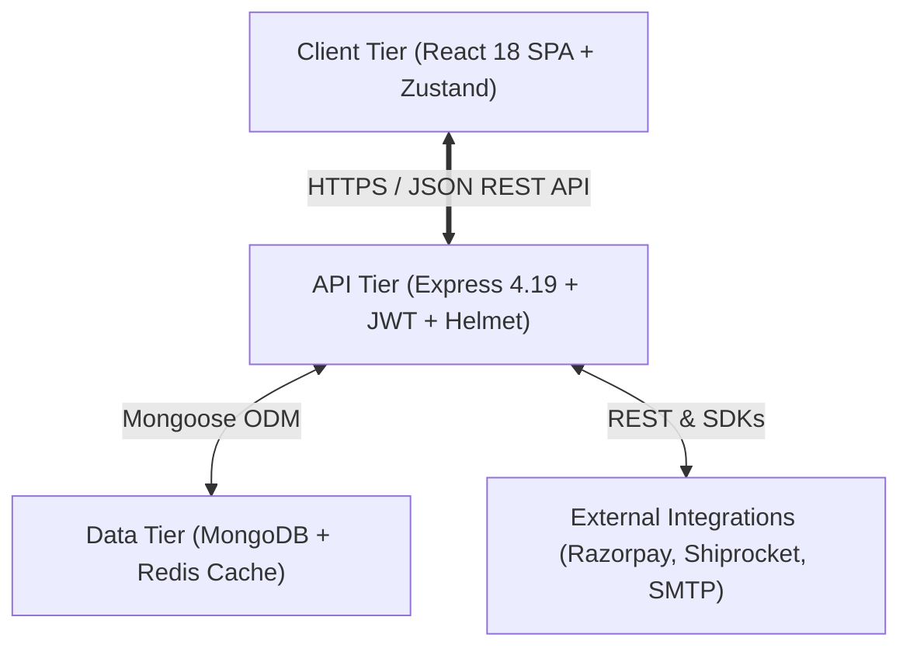

# LUXESTORE — Architecture Diagrams Index

This directory catalogs all architectural, workflow, and sequence diagrams embedded across the LUXESTORE system documentation. All diagrams are authored in standard Mermaid syntax for Markdown viewers (GitHub, VS Code, Notion, Typora).

---

## 1. High-Level 3-Tier Architecture
*Location*: [`docs/system-design.md`](../system-design.md#32-high-level-architecture-3-tier-mern-architecture)  
*Description*: Illustrates client tier (React 18 SPA, Zustand), API tier (Express, Helmet, rate-limiters, route controllers), data tier (MongoDB, Redis), and external integrations (Razorpay, Shiprocket, Cloudinary, Gmail SMTP).

---

## 2. Context-Level Data Flow Diagram (DFD Level 0)
*Location*: [`docs/system-design.md`](../system-design.md#level-0-dfd-context-level-diagram)  
*Description*: High-level boundary diagram showing data transactions between Customer, Store Administrator, LUXESTORE System, Razorpay, Shiprocket, and Gmail SMTP.

---

## 3. Entity-Relationship Diagram (ERD)
*Location*: [`docs/database-design.md`](../database-design.md#2-entity-relationship-er-diagram)  
*Description*: Complete entity-relationship model for User, Product, Product Variant, Order, Coupon, Review, Address, and EmailLog collections.

---

## 4. Sequence Diagrams
1. **User Registration & Email Verification**: [`docs/system-design.md`](../system-design.md#353-sequence-diagram-user-registration--email-verification)
2. **Customer Login & Cookie Session Generation**: [`docs/system-design.md`](../system-design.md#354-sequence-diagram-login--cookie-session-generation)
3. **Coupon Validation Flow**: [`docs/system-design.md`](../system-design.md#355-sequence-diagram-coupon-validation-flow)
4. **Checkout & Razorpay Payment Verification**: [`docs/system-design.md`](../system-design.md#356-sequence-diagram-checkout--razorpay-payment-lifecycle)
5. **Pre-Dispatch Order Cancellation**: [`docs/system-design.md`](../system-design.md#357-sequence-diagram-order-cancellation)

---

## 5. Workflow & State Diagrams
1. **Customer Purchase Workflow (Activity Diagram)**: [`docs/system-design.md`](../system-design.md#358-activity-diagram-end-to-end-customer-purchase-workflow)
2. **Order Lifecycle (State Diagram)**: [`docs/system-design.md`](../system-design.md#359-state-diagram-order-lifecycle)
3. **Deployment Topology**: [`docs/deployment-guide.md`](../deployment-guide.md#1-deployment-architecture-diagram)

