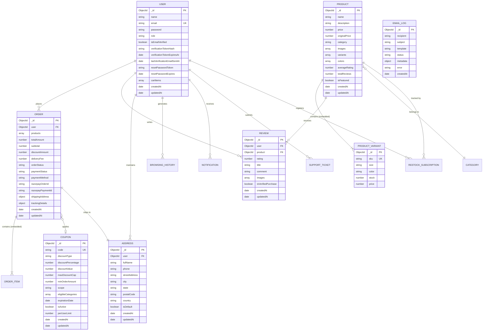

# LUXESTORE — Complete Database Design Document (DDD)

> **Database Engine**: MongoDB (Document-Oriented NoSQL)  
> **Object Data Modeling (ODM)**: Mongoose v8.5.3 on Node.js  
> **Schema Integrity**: Strict typing, pre/post middleware hooks, embedded subdocuments, compound indexes.  
> **Audit Status**: Verified Against Actual Mongoose Models (November 2026)

---

## 1. Database Architecture & Rationale

LUXESTORE utilizes **MongoDB**, a distributed document database. In e-commerce, apparel catalogs are inherently semi-structured: a bespoke wool tuxedo requires sizing attributes (chest, shoulder, sleeve length) and material swatches, whereas aviator sunglasses require polarization specifications and lens tinting.

### Key Architectural Decisions:
1. **Polymorphic Product Representation**: Relational databases enforce rigid tabular schemas requiring multiple normalized tables (`products`, `product_variants`, `variant_attributes`, `skus`). MongoDB accommodates multi-level nested subdocuments (`variants`, `colors`, `sizeGuide`) within a single collection, reducing query latency.
2. **Embedded vs. Referenced Data Decisions**:
   - **Embedded Data**: `variants` and `colors` inside `Product`, and `cartItems` inside `User`. These items are queried, modified, and rendered atomically with the parent entity.
   - **Referenced Data**: `Order` references `User` via `ObjectId` (`ref: "User"`). `Review` references `Product` and `User`. This avoids unbounded document growth and supports independent scaling of order histories.
3. **Compound & Unique Indexing**: Critical access paths (user email lookups, category filtering, coupon code matching) are indexed with uniqueness and TTL (Time-To-Live) constraints.

---

## 2. Entity-Relationship (ER) Diagram

---

## 3. Data Dictionary: Core Collections

### 3.1 Collection: `users` (`user.model.js`)
Stores authentication credentials, security verification tokens, role privileges, and embedded shopping cart items.

| Field Name | BSON Type | Constraints & Validations | Default Value | Description |
| :--- | :--- | :--- | :--- | :--- |
| `_id` | ObjectId | Primary Key | Auto-generated | Unique customer identifier |
| `name` | String | Required, trim | None | Full name of customer |
| `email` | String | Required, unique, lowercase, trim | None | Primary communication & login identity |
| `password` | String | Required, minlength: 6 | None | Salted bcrypt hash ($2a$10$...) |
| `role` | String | Enum: `["customer", "admin"]` | `"customer"` | Role-based authorization tier |
| `isEmailVerified`| Boolean | Required | `false` | Email confirmation gate |
| `accountStatus` | String | Enum: `["pending_verification", "active", "suspended"]` | `"pending_verification"` | Lifecycle status |
| `verificationTokenHash` | String | Optional | `null` | SHA-256 hash of 32-byte verification token |
| `verificationTokenExpiresAt`| Date | Optional | `null` | 15-minute token expiration timestamp |
| `lastVerificationEmailSentAt`| Date | Optional | `null` | Timestamp of last email dispatch |
| `resetPasswordToken` | String | Optional | `null` | Cryptographic SHA-256 password reset token |
| `resetPasswordExpires` | Date | Optional | `null` | 15-minute reset expiration timestamp |
| `cartItems` | Array | Array of embedded subdocuments | `[]` | Embedded items: `{ product, quantity, size, color, price }` |
| `wishlist` | Array | Array of ObjectIds (`ref: 'Product'`) | `[]` | Referenced products saved by customer |
| `createdAt` | Date | Timestamp | Current Date | Creation timestamp |
| `updatedAt` | Date | Timestamp | Current Date | Last modification timestamp |

**Indexes**:
- `email`: Unique index (`{ email: 1 }, { unique: true }`).

---

### 3.2 Collection: `products` (`product.model.js`)
Stores haute-couture catalog items, multi-variant dimensions, pricing, and aggregated review statistics.

| Field Name | BSON Type | Constraints & Validations | Default Value | Description |
| :--- | :--- | :--- | :--- | :--- |
| `_id` | ObjectId | Primary Key | Auto-generated | Product identification |
| `name` | String | Required, trim | None | Commercial product title |
| `description` | String | Required | None | High-fashion editorial product copy |
| `price` | Number | Required, min: 0 | None | Current selling price in INR (₹) |
| `originalPrice`| Number | Optional, min: 0 | `price` | Pre-discount strike-through retail price |
| `category` | String | Required, lowercase | None | Category key (e.g., `suits`, `jackets`, `jeans`) |
| `images` | Array | Array of Strings (URLs) | `[]` | Cloudinary CDN image URLs |
| `variants` | Array | Array of Variant Subdocuments | `[]` | `{ sku, size, color, stock, price, barcode }` |
| `colors` | Array | Array of Color Subdocuments | `[]` | `{ name, hex, images }` |
| `isFeatured` | Boolean | Optional | `false` | Highlighted on homepage hero showcases |
| `averageRating`| Number | Min: 0, Max: 5 | `0` | Dynamically calculated average rating |
| `totalReviews` | Number | Min: 0 | `0` | Total verified purchase reviews submitted |
| `createdAt` | Date | Timestamp | Current Date | Product creation date |

**Indexes**:
- `category`: Single index (`{ category: 1 }`).
- `isFeatured`: Single index (`{ isFeatured: 1 }`).
- Text Index on `name` and `description` for fast catalog search.

---

### 3.3 Collection: `orders` (`order.model.js`)
Captures commercial transactions, order lines, financial summaries, courier dispatch details, and lifecycle states.

| Field Name | BSON Type | Constraints & Validations | Default Value | Description |
| :--- | :--- | :--- | :--- | :--- |
| `_id` | ObjectId | Primary Key | Auto-generated | Order identifier |
| `user` | ObjectId | Required, `ref: "User"` | None | Ordering customer reference |
| `products` | Array | Array of Line Item Subdocuments | None | `{ product, quantity, price, size, color, variantId }` |
| `subtotal` | Number | Required, min: 0 | None | Sum of item prices before discount |
| `discountAmount`| Number | Min: 0 | `0` | Deducted promotional discount |
| `deliveryFee` | Number | Min: 0 | `0` | Shipping charge (₹0 if subtotal $\ge$ ₹1,999) |
| `totalAmount` | Number | Required, min: 0 | None | Final payable invoice total |
| `orderStatus` | String | Enum: `["pending", "processing", "confirmed", "shipped", "delivered", "cancelled"]` | `"processing"` | Fulfillment state |
| `paymentStatus`| String | Enum: `["pending", "paid", "failed", "refunded"]` | `"pending"` | Financial settlement status |
| `paymentMethod`| String | Enum: `["razorpay", "stripe", "cod"]` | `"razorpay"` | Settlement gateway |
| `razorpayOrderId` | String | Optional | None | Unique Razorpay order reference (`order_...`) |
| `razorpayPaymentId` | String | Optional | None | Razorpay payment transaction identifier |
| `shippingAddress` | Object | Required subdocument | None | Snapshot of address at time of purchase |
| `trackingDetails`| Object | Subdocument | `{}` | `{ courier, awb, trackingUrl, estimatedDelivery }` |

**Indexes**:
- `user`: Index (`{ user: 1 }`).
- `orderStatus`: Index (`{ orderStatus: 1 }`).
- `createdAt`: Index (`{ createdAt: -1 }`).

---

### 3.4 Collection: `coupons` (`coupon.model.js`)
Enforces promotional voucher eligibility rules, scope, discount caps, and minimum order requirements.

| Field Name | BSON Type | Constraints & Validations | Default Value | Description |
| :--- | :--- | :--- | :--- | :--- |
| `_id` | ObjectId | Primary Key | Auto-generated | Coupon record ID |
| `code` | String | Required, unique, uppercase, trim | None | Promotional voucher string (e.g., `WELCOME10`, `FASHION15`) |
| `discountType`| String | Enum: `["percentage", "fixed"]` | `"percentage"` | Discount calculation model |
| `discountPercentage`| Number | Min: 1, Max: 100 | None | Discount percentage value |
| `discountValue`| Number | Min: 0 | None | Percentage or fixed monetary value |
| `maxDiscountCap`| Number | Optional, min: 0 | None | Ceiling cap on discount (e.g. ₹1,500 or ₹2,000) |
| `minOrderAmount` | Number | Min: 0 | `0` | Minimum eligible cart subtotal required (e.g. ₹999 or ₹1,499) |
| `scope` | String | Enum: `["storewide", "category", "product"]` | `"storewide"` | Eligibility restriction boundary |
| `eligibleCategories`| Array | Array of Strings | `[]` | Category restriction list (e.g. suits, jackets, jeans) |
| `expirationDate` | Date | Required | None | Timestamp beyond which voucher expires |
| `isActive` | Boolean | Required | `true` | Administrative kill-switch |
| `perUserLimit` | Number | Min: 1 | `1` | Maximum redemptions per user |

---

### 3.5 Collection: `reviews` (`review.model.js`)
Captures purchase-verified customer feedback, ratings, review titles, and uploaded photographs.

| Field Name | BSON Type | Constraints & Validations | Default Value | Description |
| :--- | :--- | :--- | :--- | :--- |
| `_id` | ObjectId | Primary Key | Auto-generated | Review ID |
| `user` | ObjectId | Required, `ref: "User"` | None | Reviewing customer |
| `product` | ObjectId | Required, `ref: "Product"` | None | Evaluated product |
| `rating` | Number | Required, min: 1, max: 5 | None | Integer star rating |
| `title` | String | Optional, trim | None | Review headline |
| `comment` | String | Required, trim | None | Full text feedback |
| `images` | Array | Array of Strings | `[]` | Customer-uploaded Cloudinary photo URLs |
| `isVerifiedPurchase` | Boolean | Required | `true` | Verified against non-cancelled paid order |

---

### 3.6 Auxiliary Collections Inventory

1. **`addresses`**: Normalized address book with normalized E.164 phone numbers and `isDefault` flags.
2. **`newsletters`**: Marketing email subscriptions with lowercase normalization.
3. **`browsinghistories`**: Product view logs deduplicated per product.
4. **`notifications`**: In-app customer alerts for orders and restocks.
5. **`supporttickets`**: Customer care thread communications.
6. **`serviceablelocations`**: Delivery postal codes and courier routes.
7. **`categories`**: Apparel taxonomies.
8. **`sales`**: Timed flash sale promotions.
9. **`announcements`**: Marquee announcement banners.
10. **`campaignslides`**: Hero campaign photographs.
11. **`cmscontents`**: Brand policies and editorial texts.
12. **`sizecharts`**: Category measurement matrices.
13. **`storelocations`**: Physical atelier geographic coordinates.
14. **`warehousesettings`**: Origin postal codes for Shiprocket dispatch.
15. **`emaillogs`**: Audit trail of all transactional emails dispatched.
16. **`searchqueries`**: Search query frequency logs.
17. **`restocksubscriptions`**: Back-in-stock alerts on out-of-stock SKUs.
