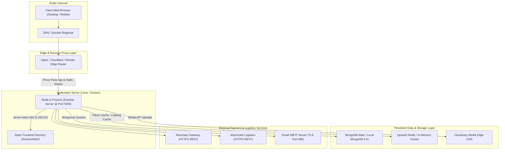

# LUXESTORE — Deployment, Infrastructure & Environment Guide

> **Deployment Architecture**: Unified Monolith / Tiered Microservice Ready  
> **Backend Server**: Node.js v18+ with Express v4.19  
> **Frontend Bundler**: Vite v5.4 serving pre-rendered SPA assets from `frontend/dist`  
> **Security Notice**: Contains **variable names only**; zero sensitive secrets, passwords, or private keys.

---

## 1. Deployment Architecture Diagram



---

## 2. Environment Variables Reference Manual

The following environment variables must be configured in `.env` located in the root repository.

| Variable Name | Required | Architectural Role | Sample Description / Format |
| :--- | :--- | :--- | :--- |
| **`PORT`** | Optional | Backend HTTP listener port | Default: `5000` |
| **`NODE_ENV`** | Required | Runtime environment flag | `development` or `production` |
| **`MONGO_URI`** | Required | MongoDB connection URI | `mongodb+srv://<user>:<pwd>@cluster.mongodb.net/ecommerce` |
| **`UPSTASH_REDIS_URL`** | Optional | Redis connection URL | `rediss://default:<token>@<host>:6379` (Gracefully skips if omitted) |
| **`ACCESS_TOKEN_SECRET`** | Required | Secret for signing 15m JWT access tokens | 64-character high-entropy hex string |
| **`REFRESH_TOKEN_SECRET`**| Required | Secret for signing 7d JWT refresh tokens | 64-character high-entropy hex string |
| **`CLIENT_URL`** | Required | Client URL for CORS origin whitelisting | `http://localhost:5173` or `https://luxestore.in` |
| **`CLOUDINARY_CLOUD_NAME`**| Required | Cloudinary media storage bucket name | String name from Cloudinary dashboard |
| **`CLOUDINARY_API_KEY`** | Required | Cloudinary API Key | Alphanumeric API credential |
| **`CLOUDINARY_API_SECRET`**| Required | Cloudinary API Secret | Alphanumeric secret credential |
| **`RAZORPAY_KEY_ID`** | Required | Public Razorpay identifier | `rzp_test_...` (Test) or `rzp_live_...` (Prod) |
| **`RAZORPAY_KEY_SECRET`** | Required | Razorpay cryptographic secret | Used for HMAC-SHA256 signature verification |
| **`EMAIL_USER`** | Required | Outbound email sender address | `atelier@gmail.com` |
| **`EMAIL_PASS`** | Required | Outbound email provider app password | 16-character Gmail App Password |
| **`SMTP_HOST`** | Optional | Custom SMTP Host | Default: `smtp.gmail.com` |
| **`SMTP_PORT`** | Optional | Custom SMTP Port | Default: `465` (Secure) or `587` |
| **`SHIPROCKET_EMAIL`** | Optional | Shiprocket login email | Logistics serviceability account |
| **`SHIPROCKET_PASSWORD`** | Optional | Shiprocket account password | Logistics serviceability account |
| **`PICKUP_PINCODE`** | Optional | Warehouse dispatch postal code | Default: `144411` |

---

## 3. Local Development Setup Instructions

### Prerequisites
1. **Node.js**: Version 18.x to 24.x installed (`node -v`).
2. **MongoDB**: Local MongoDB instance running on `mongodb://127.0.0.1:27017` or a MongoDB Atlas cluster URI.
3. **Git**: Version 2.x+ installed.

### Step-by-Step Installation

```bash
# 1. Clone the repository
git clone https://github.com/your-username/luxestore.git
cd luxestore/mern-ecommerce

# 2. Install backend dependencies
npm install

# 3. Install frontend dependencies
npm install --prefix frontend

# 4. Configure environment variables
# Copy template and fill required keys
cp .env.example .env

# 5. Seed the initial product catalog (Optional)
node backend/seeds/seed_catalog.js

# 6. Start development servers concurrently
# Terminal 1: Backend API
npm run dev

# Terminal 2: Frontend Client (Vite HMR)
npm run dev --prefix frontend
```
The application will be accessible at:
- Frontend: `http://localhost:5173`
- Backend API: `http://localhost:5000/api`

---

## 4. Production Build & Deployment Pipeline

### 4.1 Production Build
In production, the Express backend serves the static assets compiled by Vite:

```bash
# Execute Vite production bundle
npm run build --prefix frontend

# Verify that frontend/dist/ directory is populated
# dist/index.html
# dist/assets/*.css
# dist/assets/*.js
```

### 4.2 Starting the Monolithic Server
When `NODE_ENV=production`, `server.js` automatically binds `/` to `frontend/dist/index.html`:

```bash
export NODE_ENV=production
node backend/server.js
```

### 4.3 Process Management with PM2
For high availability on Linux VPS/cloud instances:
```bash
# Install PM2 globally
npm install -g pm2

# Launch application cluster
pm2 start backend/server.js --name "luxestore-api" -i max

# Configure auto-restart on system reboot
pm2 startup
pm2 save
```

---

## 5. Database Backup & Disaster Recovery

### 5.1 MongoDB Dump (Backup)
```bash
# Backup database to local snapshot directory
mongodump --uri="<MONGO_URI>" --out=/backup/mongodb-$(date +%F)
```

### 5.2 MongoDB Restore (Recovery)
```bash
# Restore database from snapshot directory
mongorestore --uri="<MONGO_URI>" /backup/mongodb-2026-11-03/ecommerce
```

