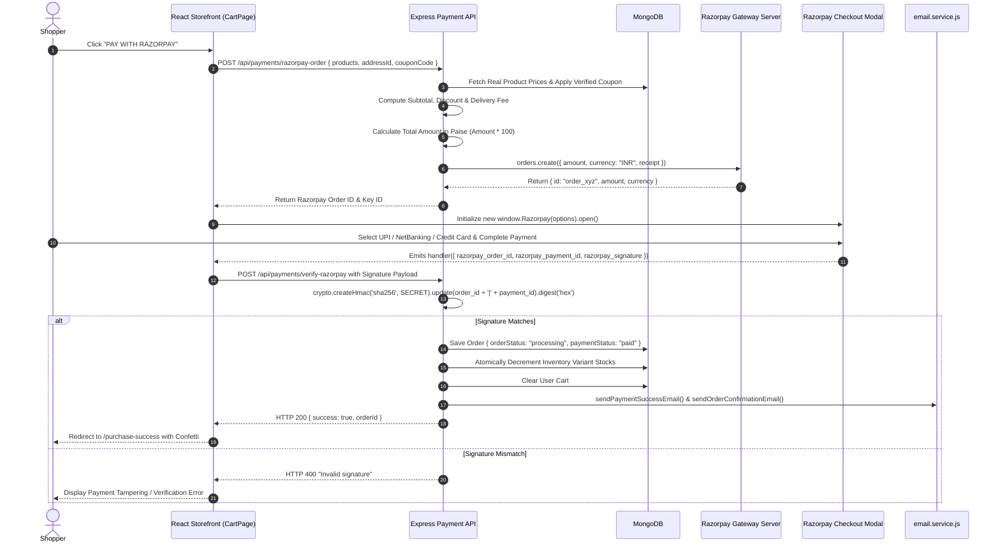
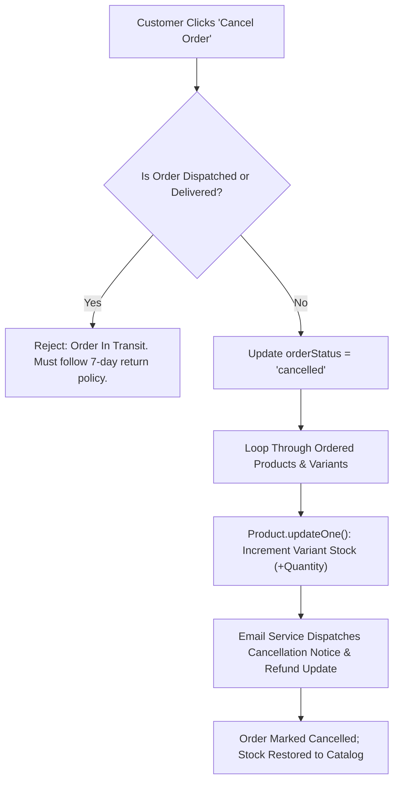

# LUXESTORE — Payment & Shipping Workflow Specification

> **Modules**: Financial Settlement (Razorpay) & Logistics Fulfillment (Shiprocket)  
> **Currency Unit**: Indian Rupee (INR / ₹), represented in Paise for Gateway transactions  
> **Free Shipping Threshold**: ₹1,999 Cart Subtotal  
> **Audit Status**: Verified via Live Checkout API Execution (November 2026)

---

## 1. Razorpay Payment Gateway Integration Lifecycle

LUXESTORE implements the **Razorpay Standard Checkout** flow with strict server-side calculation and cryptographic verification.

### 1.1 Server-Side Monetary Safety
1. **Zero Client Price Trust**: The client never passes the final amount to pay. The backend independently queries each product from the database by its `productId` and `variantId`, calculates the mathematical subtotal, validates any active coupon code, adds the appropriate delivery fee, and converts the total to integer paise (`Math.round(totalAmount * 100)`).
2. **Double-Crediting Prevention**: Once a `razorpay_order_id` is verified and an order document is created, that order ID cannot be reused. If a user attempts to resubmit the same signature, the backend rejects it.
3. **Webhook Processing Ready**: In `backend/server.js`, `express.json({ verify: (req, res, buf) => { req.rawBody = buf; } })` captures raw request buffers, allowing HMAC validation of Razorpay Webhook notifications for asynchronous status reconciliations.

---

## 2. Delivery Fee Calculation Engine

Delivery charges are determined deterministically according to the store's threshold rules:

$$\text{Delivery Fee} = \begin{cases} 
₹0 \quad (\text{FREE}), & \text{if } \text{Subtotal} \ge ₹1,999 \\
\text{Configured Partner Rate (₹93.72)}, & \text{if } \text{Subtotal} < ₹1,999 
\end{cases}$$

### Live Tested Calculation Scenarios:

| Scenario | Cart Item & Price | Applicable Coupon | Subtotal | Delivery Fee | Payable Total | Gateway Amount (Paise) |
| :--- | :--- | :--- | :--- | :--- | :--- | :--- |
| **Below Free Threshold** | Silk Pocket Square (₹1,499) | None | ₹1,499.00 | ₹93.72 | **₹1,592.72** | `159272` paise |
| **Above Free Threshold** | Italian Wool Tuxedo (₹14,999) | `WELCOME10` (Cap ₹1,500) | ₹14,999.00 | ₹0.00 (FREE) | **₹13,499.00** | `1349900` paise |
| **Above Free Threshold** | Italian Wool Tuxedo (₹14,999) | `FASHION15` (Cap ₹2,000) | ₹14,999.00 | ₹0.00 (FREE) | **₹12,999.00** | `1299900` paise |

The exact same threshold logic is enforced in the frontend store `OrderSummary.jsx`, ensuring zero discrepancy between the customer's displayed summary and the amount authorized by Razorpay.

---

## 3. Shiprocket Logistics Fulfillment Engine

### 3.1 Architecture of `shiprocket.service.js`
The logistics layer provides real-time integration with **Shiprocket REST API v2**:
1. **Authentication & Token Caching**: Obtains JWT authorization tokens from Shiprocket using `SHIPROCKET_EMAIL` and `SHIPROCKET_PASSWORD`, caching the token in memory to avoid repetitive login overhead.
2. **PIN Code Serviceability**:
   - Queries Shiprocket courier partners (Blue Dart, Delhivery, Shadowfax, DTDC) with origin postal code (Atelier Warehouse: `144411` Jalandhar) and customer destination postal code.
   - Evaluates Air vs. Surface routing, estimated delivery days, and COD availability.
   - If Shiprocket credentials are unconfigured or the network fails, the service falls back gracefully to a calculated standard delivery ETA based on postal zone distance.
3. **Order Creation in Shiprocket**:
   - Compiles package weight, dimensions (Length $\times$ Breadth $\times$ Height in cm), pickup location nickname, and invoice value.
   - Returns AWB (Air Waybill) tracking number.

---

## 4. Order Cancellation & Stock Reversal Lifecycle

LUXESTORE implements an automated stock reversal mechanism upon order cancellation:

### Verification in Automated Test Suite
- Verified via `backend/order_cancellation_razorpay.test.js` and `test_complete_bugfix_suite.js`.
- Confirmed that variant stock levels in MongoDB increment back to pre-order inventory upon cancellation.
