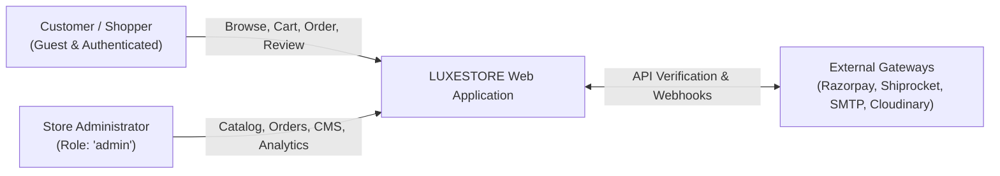

# LUXESTORE — Project Overview & Academic Abstract

> **Degree / Program**: Bachelor of Technology (B.Tech) in Computer Science & Engineering  
> **Course / Capstone**: Final Year Project & Technical Defense  
> **Project Title**: LUXESTORE — Haute Atelier & Luxury Fashion E-Commerce Web Platform  
> **Architecture**: Full-Stack MERN (MongoDB, Express.js, React.js, Node.js) with Redis & External Gateway Integrations  

---

## 1. Executive Summary & Project Introduction

**LUXESTORE** is a full-stack, enterprise-grade e-commerce application engineered specifically for the luxury apparel and haute-couture fashion retail vertical. Unlike generic mass-market commerce websites, high-end fashion platforms require a synthesis of editorial visual presentation, real-time variant-level inventory control (SKU, size, color), deterministic delivery logistics verification, secure payment processing, and resilient transactional notifications.

The project demonstrates the end-to-end engineering lifecycle of an asynchronous, distributed web system developed under the **MERN** stack paradigm. It combines a client-side Single Page Application (SPA) driven by React 18, Vite, Tailwind CSS, and Zustand with a modular Express.js backend server backed by MongoDB Atlas / Community document database, an in-memory Redis caching tier, Cloudinary media storage, Razorpay checkout gateway, and Shiprocket logistics services.

---

## 2. Problem Statement

Modern online fashion retailing presents several architectural and operational challenges:

1. **Editorial Presentation vs. Web Performance**: High-resolution imagery in fashion platforms often results in slow initial page loads, layout shifts, and degraded user engagement. An optimized media delivery pipeline with responsive layouts, caching, and lazy loading is vital.
2. **Complex Product Variant Dimensions**: Apparel products possess multi-dimensional variance (e.g., sizes: XS to XXL; colors with distinct hex codes; individual SKU stocks). Traditional flat relational product catalogs struggle with dynamic SKU management without convoluted join tables.
3. **Logistics & PIN-Code Serviceability Friction**: In developing e-commerce markets (such as India), shipping coverage and cash-on-delivery (COD) availability vary across postal codes. Lack of pre-checkout courier verification causes high Return-to-Origin (RTO) rates and order cancellations.
4. **Authentication Vulnerabilities & Deliverability Issues**: Unreliable third-party phone OTP SMS aggregators cause authentication abandonment. A deterministic, secure, email-based verification pipeline utilizing cryptographically signed tokens is essential.
5. **Coupons & Discount Exploitation**: E-commerce stores suffer revenue loss when promo codes fail to enforce minimum order thresholds, product-category eligibility, or single-use quotas.

---

## 3. Proposed Solution

LUXESTORE resolves these problems through an integrated, service-oriented web architecture:

- **Ultra-Fast Single Page Application**: Powered by Vite and React 18 with Zustand for lightweight, reactive state management and Framer Motion for editorial page transitions.
- **Hierarchical Document Modeling**: MongoDB schemas utilizing embedded variant subdocuments (`variants` array with SKU, size, color, stock, and barcode) and dynamic indexing for fast search and aggregation.
- **Logistics Integration**: A dual-tier delivery engine checking live Shiprocket courier serviceability APIs for postal code delivery windows, with automated fallback to free delivery on orders $\ge$ ₹1,999.
- **Financial-Grade Transaction Verification**: Razorpay payment order generation coupled with server-side HMAC-SHA256 signature verification to prevent payment tampering and double-crediting.
- **Pure Email Authentication System**: Hardened password hashing using `bcryptjs` (salt rounds: 10), HTTP-only JWT cookies (`accessToken`: 15m; `refreshToken`: 7d), secure email verification links containing a 32-byte (64 hex characters) cryptographic token (hashed with SHA-256 and expiring in 15 minutes), and 15-minute expiring password reset tokens dispatched via Gmail SMTP. Zero phone OTP or third-party social OAuth dependencies.
- **Purchase-Verified Feedback**: Product reviews are restricted strictly to customers who have purchased and paid for the item in an order marked as `paid` or `captured`.

---

## 4. System Objectives

| Objective | Target Specification | Realization in Codebase |
| :--- | :--- | :--- |
| **Data Integrity** | ACID compliance at document level; variant stock consistency | Mongoose Schema validators, pre-save hooks, atomic updates |
| **Authentication Security** | XSS and CSRF mitigation; secure session handling | HTTP-only Cookies, Helmet headers, express-rate-limit |
| **Editorial UX** | Split-screen login, curated carousels, instant sort & filter | Tailwind CSS 3.4, Framer Motion 11.3, Lucide React icons |
| **Logistics Accuracy** | Real-time PIN code verification; partner courier routing | Shiprocket REST API with in-memory caching and fallback |
| **Extensibility** | Modular RESTful API structure | 22 dedicated route files and 24 controllers |

---

## 5. Target Stakeholders & System Actors



### 1. Guest Shopper
- Unauthenticated visitor browsing collections, editorial campaign slides, announcements, and product detail pages.
- Can view size charts, search products, check postal code serviceability, and join the newsletter.

### 2. Authenticated Customer
- Registered user verified via email token URL link.
- Maintains saved delivery addresses, cart items, wishlists, order histories, shipment tracking modals, and order cancellation requests.
- Submits purchase-verified ratings and reviews.

### 3. Store Administrator (`role: "admin"`)
- Back-office operator accessing the Admin Dashboard (`/secret-dashboard`).
- Controls products (CRUD), categories, inventory, flash sales, campaign hero slides, announcements, CMS content, coupon codes, and customer support tickets.
- Analyzes revenue, conversion rates, and sales trends.

> **Status of Seller Functionality**: Codebase inspection confirms that multi-vendor marketplace features (independent merchant onboarding, seller sub-dashboards, automated split payouts) are **not implemented** in the current application. All inventory and fulfillment are managed centrally under the unified Store Administrator. Multi-vendor seller support is formally documented as a planned future enhancement.

---

## 6. System Boundaries & Operating Context

LUXESTORE operates as a multi-tier client-server application:

```
[Web Browser Client] 
       │  (HTTPS / JSON REST API)
       ▼
[Express 4.19 Server @ Node.js] ── (Cache Read/Write) ──► [Redis Cache]
       │                                                         │ (Fallback if Offline)
       ├── (Mongoose ODM) ────────► [MongoDB Atlas / Local DB] ◄─┘
       ├── (SDK / HTTPS REST) ────► [Cloudinary CDN] (Images)
       ├── (HMAC-SHA256) ─────────► [Razorpay Gateway] (Payments)
       ├── (REST API) ────────────► [Shiprocket Logistics] (Shipping)
       └── (SMTP TLS / SSL) ──────► [Gmail SMTP Service] (Transactional Emails)
```

The system is fully containerizable and environment-agnostic, capable of operating locally using fallback services or in cloud environments (Render, AWS, Railway, Vercel).

---

## 7. Educational Project Disclaimer & Intellectual Property

"LUXESTORE is an independently developed educational e-commerce project created for learning, experimentation, academic presentation and portfolio demonstration. It is not affiliated with or endorsed by any third-party brand or business. All third-party trademarks, services and assets remain the property of their respective owners. Original project content and assets are used wherever possible. Third-party software and services are subject to their respective licenses and terms."

