# LUXESTORE — System Design Document (SDD)

> **Document Class**: Architectural & Detailed System Design Specification  
> **Target Audience**: Academic Defense Panel, Software Architects, Full-Stack Engineers  
> **Application**: LUXESTORE Haute Atelier E-Commerce Web Application  
> **Status**: Verified Against Live Implementation (November 2026)

---

## 3.1 System Overview

### 3.1.1 Introduction & Problem Context
LUXESTORE is an enterprise-grade luxury e-commerce web platform engineered using the MERN stack. High-end apparel retail demands exacting standards: high-resolution editorial photography, complex multi-dimensional inventory (variants defined by size, color, SKU, and physical dimensions), reliable checkout verification, transparent purchase-verified ratings, and real-time courier serviceability checks.

### 3.1.2 Major Capabilities
- **Curated Storefront**: Dynamic editorial hero carousel, campaign slides, category collections, and sales showcases.
- **Intelligent Product Catalog**: Multi-variant SKU management, stock tracking, color swatches, dynamic size guides, and visual location mapping.
- **Deterministic Delivery**: Live courier serviceability engine with postal code checks, estimated delivery windows, and automated free delivery for orders $\ge$ ₹1,999.
- **Enterprise Checkout & Payments**: Razorpay INR payment order generation with server-side HMAC-SHA256 signature verification.
- **Hardened Email Authentication**: 32-byte cryptographically secure verification URL links, dual JWT HTTP-only cookies (`accessToken` 15m / `refreshToken` 7d), and 15-minute password reset links via Gmail SMTP.
- **Purchase-Verified Feedback**: Reviews can only be submitted by customers with verified, completed, and non-cancelled orders for that specific item.

---

## 3.2 High-Level Architecture (3-Tier MERN Architecture)

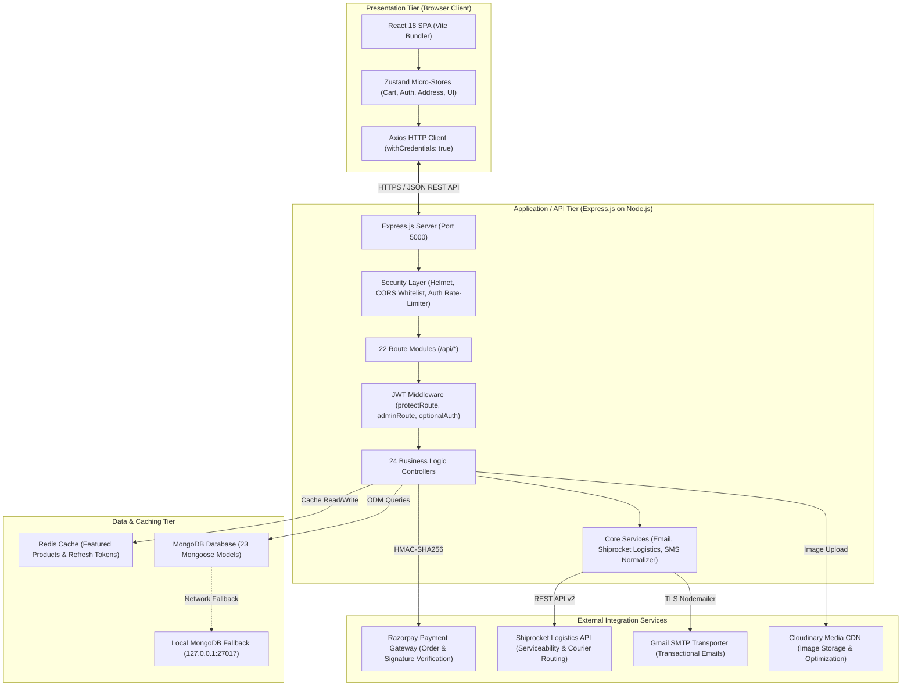

---

## 3.3 Low-Level Design (LLD)

### 3.3.1 Architectural Pattern: Controller-Service-Model
The application enforces strict separation of concerns:
1. **Routes (`/backend/routes/`)**: Map URI patterns and HTTP verbs to middleware pipelines and controller actions.
2. **Middleware (`/backend/middleware/`)**: Perform request interception:
   - `protectRoute`: Extracts `req.cookies.accessToken`, decodes userId, validates against database, and injects `req.user`.
   - `adminRoute`: Checks `req.user.role === 'admin'`.
   - `optionalAuth`: Gracefully populates `req.user` without rejecting unauthenticated guests.
3. **Controllers (`/backend/controllers/`)**: Parse request parameters/body, execute business validation, perform calculations, and return standard JSON responses `{ success, data, message }`.
4. **Services (`/backend/services/`)**: Encapsulate complex integrations (e.g., Shiprocket token management, Nodemailer templates, phone number normalization).
5. **Models (`/backend/models/`)**: Define Mongoose schemas with type safety, validations, default values, and indexes.

### 3.3.2 API Request Lifecycle

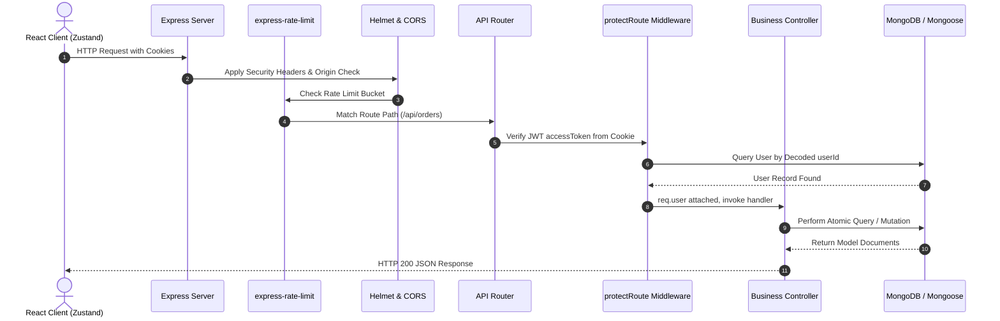

---

## 3.4 Data Flow Diagrams (DFDs)

### Level 0 DFD: Context-Level Diagram

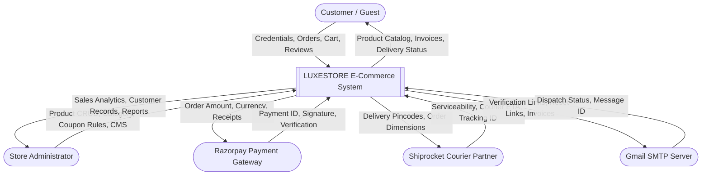

### Level 1 DFD: Subsystem Decomposition

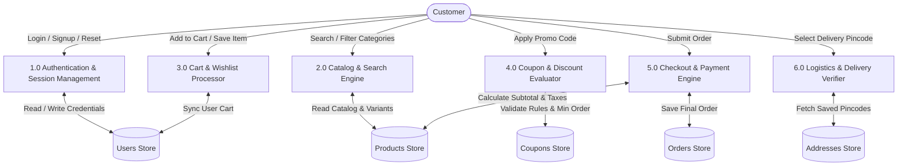

### Level 2 DFD: Coupon Validation & Checkout Flow

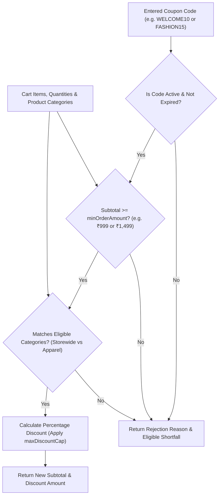

---

## 3.5 UML Diagrams

### 3.5.1 Use Case Diagram

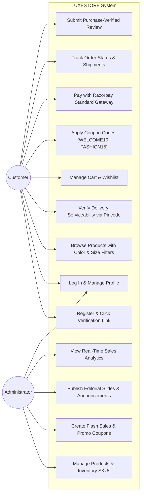

### 3.5.2 Domain Class Diagram

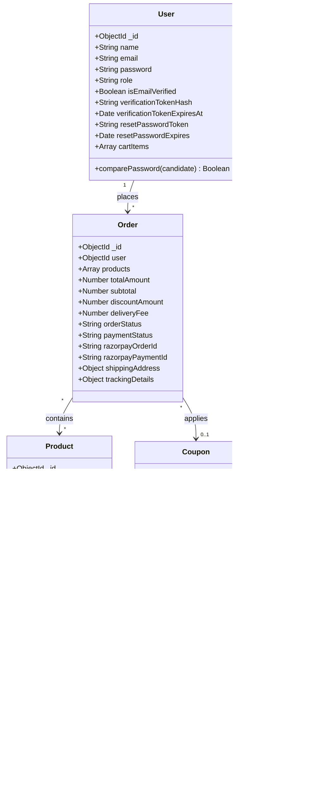

### 3.5.3 Sequence Diagram: User Registration & Real Email Link Verification

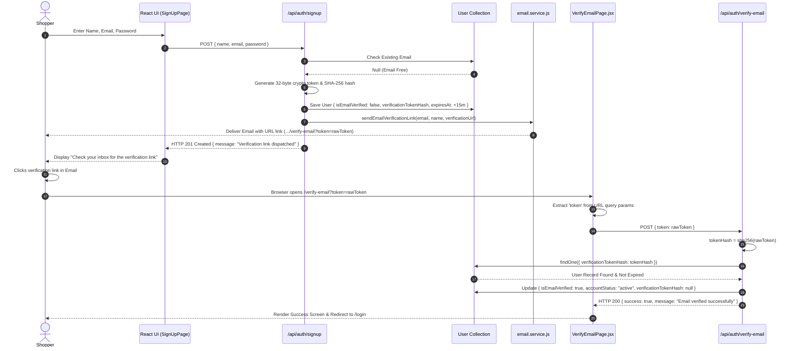

### 3.5.4 Sequence Diagram: Login & Cookie Session Generation

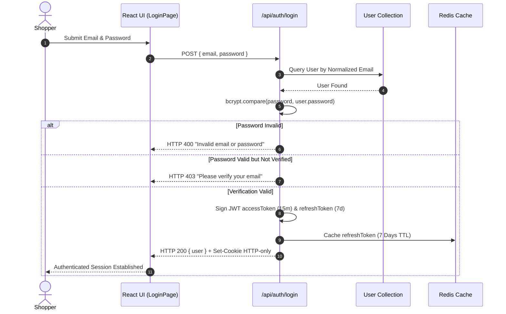

### 3.5.5 Sequence Diagram: Live Coupon Validation Flow (WELCOME10 & FASHION15)

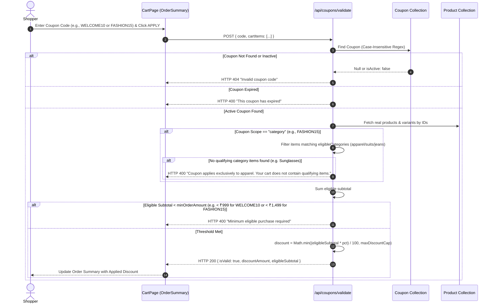

### 3.5.6 Sequence Diagram: Checkout & Razorpay Payment Lifecycle

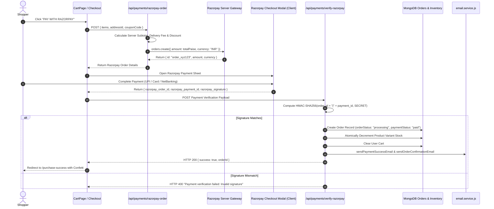

### 3.5.7 Sequence Diagram: Order Cancellation

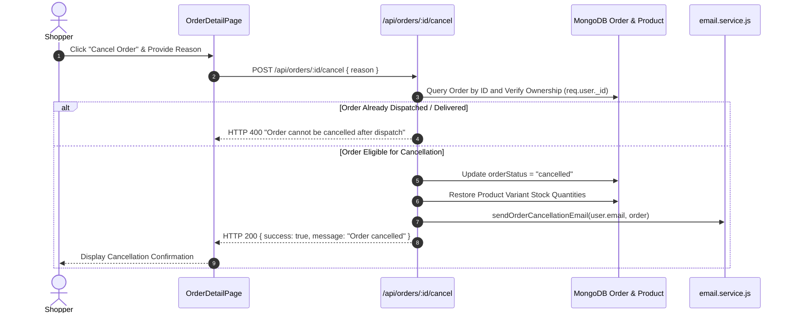

### 3.5.8 Activity Diagram: End-to-End Customer Purchase Workflow

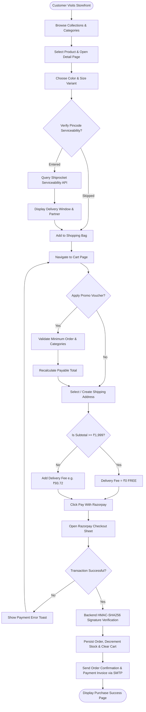

### 3.5.9 State Diagram: Order Lifecycle

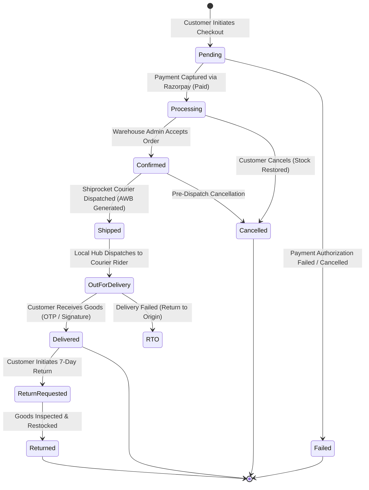

---

## 3.6 Architectural Design Decisions & Trade-offs

| Design Decision | Technology / Choice | Academic Justification & Trade-off Evaluation |
| :--- | :--- | :--- |
| **Full-Stack JavaScript (MERN)** | Node.js + Express + React | Eliminates context switching between client and server. Enables shared data contracts (JSON) across the entire application stack. |
| **Document Database** | MongoDB + Mongoose | Apparel products exhibit polymorphic attributes (e.g., shoe dimensions vs. coat chest measurements). MongoDB embedded arrays (`variants`, `colors`) enable subdocument querying without multi-table SQL joins. |
| **Client State Management** | Zustand | Avoids the heavy boilerplate of Redux and the unnecessary re-render penalties of React Context. Zustand micro-stores allow direct outside-React access. |
| **Session Security** | HTTP-Only Cookies (Dual JWT) | Mitigates Cross-Site Scripting (XSS) attacks by preventing JavaScript `document.cookie` reads. Short-lived 15m `accessToken` paired with 7-day `refreshToken`. |
| **Caching Layer** | Redis with Graceful Fallback | In-memory key-value caching prevents database spikes on popular categories while the try-catch wrapper guarantees zero downtime if Redis is unreachable. |
| **Media Delivery** | Cloudinary CDN | High-resolution editorial photography is hosted and dynamically transformed on an external edge CDN, preventing web server storage exhaustion. |
| **Seller Marketplace Architecture** | *Unimplemented / Planned* | Single-tenant store administration in current release; multi-vendor marketplace with automated split payouts is formally scheduled for future milestones. |
